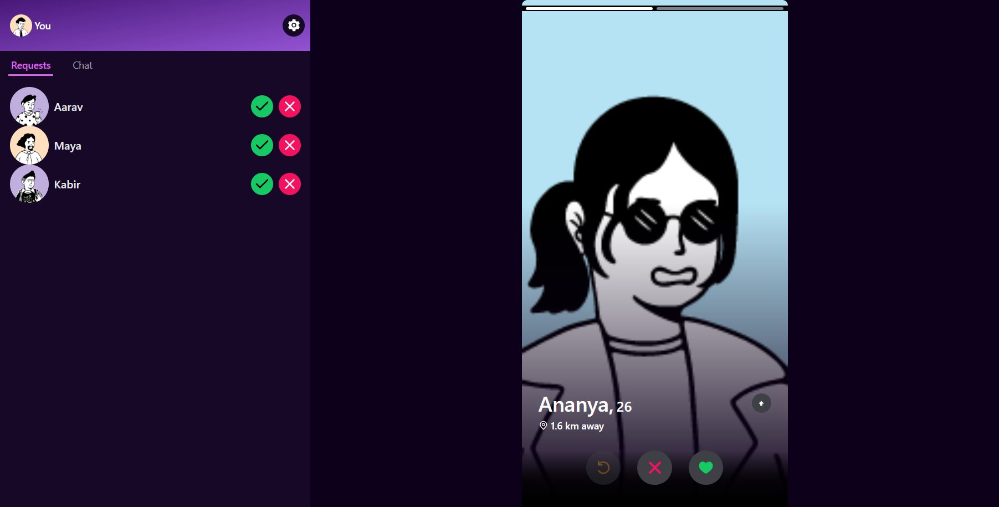
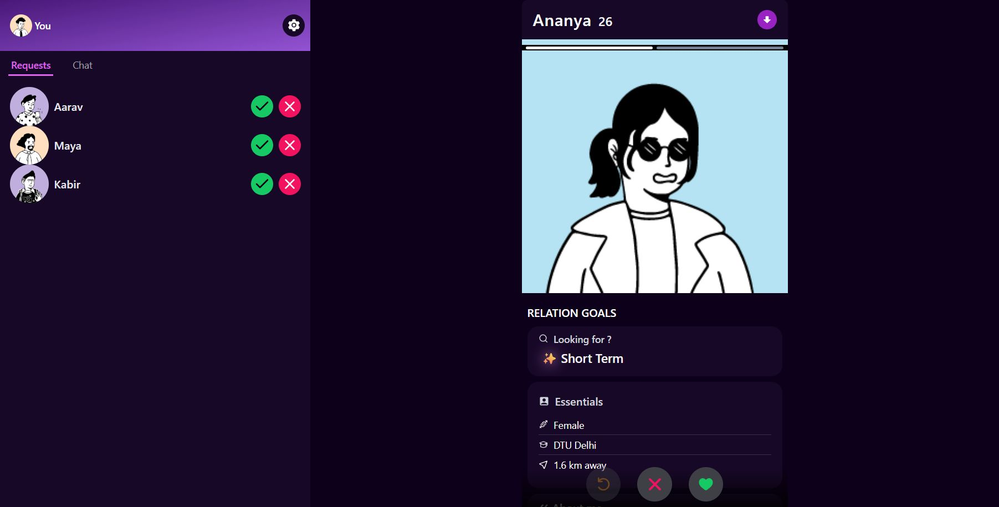
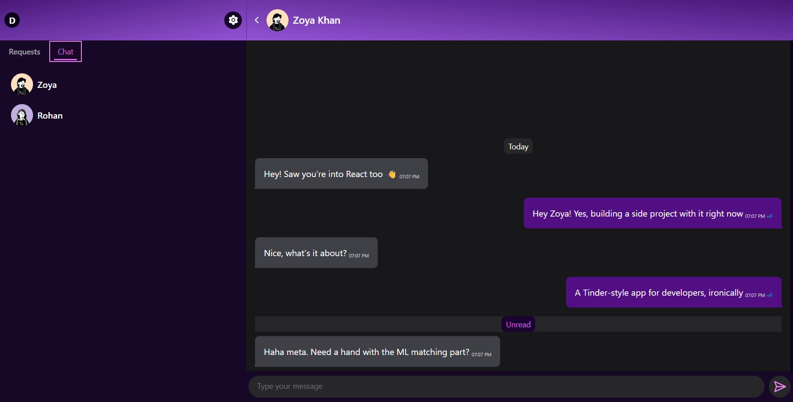
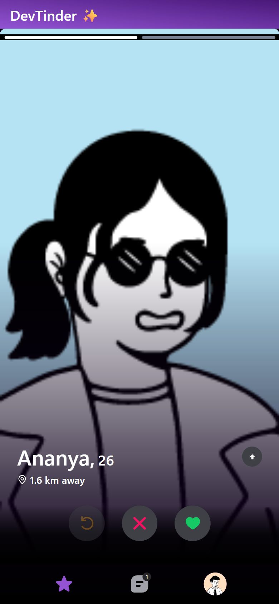
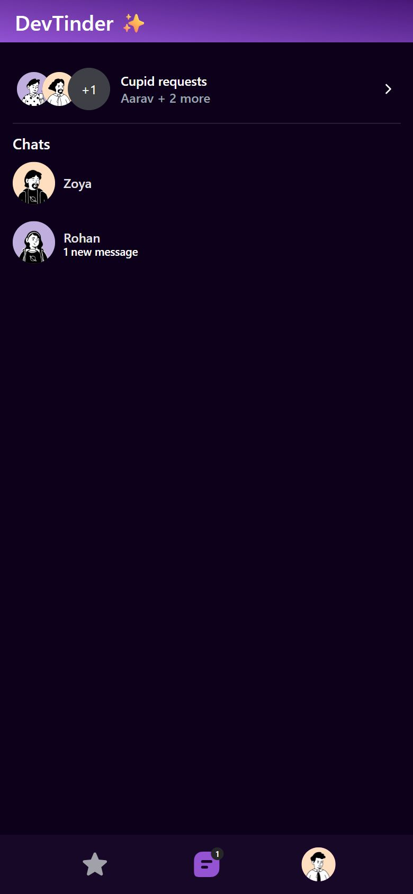

# DevTinder

**Swipe, match and chat with developers near you.** DevTinder is a full-stack, Tinder-style app for finding coding partners. You swipe on developer profiles, match when the interest is mutual, and chat in real time with online status and read receipts.

This repo is the **React frontend**. The API lives in [dev-tinder-server](https://github.com/priyanshuspawar/dev-tinder-server).

> **Live demo:** _coming soon_
> Log in with `demo@demo.devtinder.dev` / `Demo@1234`. The account has pending requests, matches and chat history.



| Full profile | Real-time chat |
|---|---|
|  |  |

| Mobile feed | Mobile chats |
|---|---|
|  |  |

## Features

- **Swipe feed:** drag a card or use the buttons to like or pass. Cards fly off, snap back below the threshold, and **Undo** brings back your last swipe. Tap through photos, expand to the full profile, and see shared skills highlighted and the real distance ("1.6 km away").
- **Matching:** a like becomes a request. The other person accepts or rejects it from their sidebar (desktop) or the requests screen (mobile), and new requests arrive in real time.
- **Real-time chat:** Socket.IO messaging with sent → delivered → read ticks, an "Unread" divider, paged history in both directions, online status, and offline messages delivered on reconnect.
- **Profiles:** up to 5 photos (UploadThing), bio, skills, "looking for", essentials, and an edit / preview mode. A completion score gates the feed at 70%.
- **Location-aware:** uses the browser's location to show distances, with clear screens for pending, denied and unavailable permission.
- **Responsive:** sidebar layout on desktop, bottom navigation on phones (≤ 895px).

## Tech stack

React 18 · Vite 5 · TypeScript · HeroUI + Tailwind CSS · TanStack Query · Zustand · React Router 6 · react-hook-form + zod · Motion (framer-motion) · socket.io-client

Architecture, routes, state and flows are documented in [DESIGN.md](DESIGN.md).

## Run locally

You'll need [Bun](https://bun.sh) and the [API server](https://github.com/priyanshuspawar/dev-tinder-server) running on port 5000.

```bash
bun install
cp .env.example .env      # VITE_API_URL=http://localhost:5000
bun run dev               # http://localhost:5173
```

To get a populated feed, run `bun run seed` in the server repo and log in as the demo user.

| Script | What it does |
|---|---|
| `bun run dev` | Vite dev server |
| `bun run build` | Type-check (`tsc`) + production build into `dist/` |
| `bun run preview` | Serve the production build |
| `bun run lint` | ESLint with autofix |

## Deploy

The frontend is a static Vite build that deploys to **Vercel** (`vercel.json` already rewrites all routes to the SPA). Set `VITE_API_URL` to your API URL. It's baked in at build time. See the server repo's [progress.md](https://github.com/priyanshuspawar/dev-tinder-server/blob/main/progress.md#hosting-plan-all-free-tiers-check-current-limits-before-signing-up) for the free hosting plan and the cross-site cookie caveat.

## License

[MIT](LICENSE) © Priyanshu Singh Pawar. Demo avatars are [DiceBear "Notionists"](https://www.dicebear.com/styles/notionists/) (CC0).
